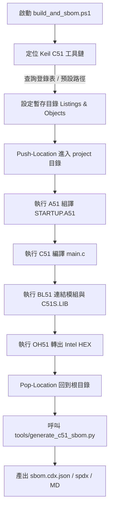

# 操作指南：在 Windows PowerShell / CI/CD 執行無頭自動化建置

本指南說明如何在沒有 GUI 圖形介面（Headless）的 Windows 終端機或持續整合（CI/CD，如 GitHub Actions Runner、GitLab Runner、Jenkins）環境中，自動化編譯標準 8051 韌體並產生 SBOM。

---

## 適用情境

- 搭建自動化持續整合伺服器（CI Runner）。
- 批次夜間建置（Nightly Build）與資安相依性自動稽核流程。
- 需要標準退出碼（Exit Code `0` 表示成功，非 `0` 表示失敗）進行流程控管。

---

## 快速執行

在專案根目錄下，開啟 PowerShell 執行：

```powershell
powershell -ExecutionPolicy Bypass -File .\build_and_sbom.ps1
```

若 Keil C51 安裝在非標準路徑，可透過 `-KeilPath` 參數指定：

```powershell
powershell -ExecutionPolicy Bypass -File .\build_and_sbom.ps1 -KeilPath "D:\Tools\Keil_v5\C51"
```

---

## 腳本執行內部架構

`build_and_sbom.ps1` 實作了嚴格的自動化防禦機制：



### 關鍵技術處理：相對路徑切換（Push-Location）
由於 Windows 使用者主目錄或專案路徑可能包含空格（例如 `C:\Users\tester\Desktop\c51 sbom\`），而 Keil BL51 連結器在解析逗號分隔的模組參數（如 `STARTUP.obj, main.obj`）時，若使用帶空格的絕對路徑會觸發 `FATAL ERROR L204: INVALID KEYWORD`。

為此，`build_and_sbom.ps1` 在編譯前自動切換工作目錄至 `project/`，使用相對路徑傳遞給工具鏈，編譯完成後還原路徑，徹底解決路徑包含空格導致的連結器失敗問題。

---

## CI/CD 整合範例 (GitHub Actions Windows Runner)

以下為 `.github/workflows/firmware-sbom.yml` 範例設定：

```yaml
name: Build Firmware and SBOM

on:
  push:
    branches: [ main ]
  pull_request:
    branches: [ main ]

jobs:
  build:
    runs-on: windows-latest

    steps:
      - name: Checkout Repository
        uses: actions/checkout@v4

      - name: Set up Python
        uses: actions/setup-python@v5
        with:
          python-version: '3.10'

      - name: Run Build and SBOM Pipeline
        run: |
          powershell -ExecutionPolicy Bypass -File .\build_and_sbom.ps1

      - name: Run Verification Tests
        run: |
          python -m unittest discover -s tests

      - name: Archive Firmware & SBOM Artifacts
        uses: actions/upload-artifact@v4
        with:
          name: firmware-sbom-package
          path: |
            project/Objects/w78_std_8051.hex
            sbom/sbom.cdx.json
            sbom/sbom.spdx.json
            sbom/SBOM-REPORT.md
```

---

## 驗證執行結果

- **檢查退出碼**：在 PowerShell 中檢查 `$LASTEXITCODE`，值應為 `0`。
- **檢查檔案完整性**：
  ```powershell
  Test-Path "project\Objects\w78_std_8051.hex", "sbom\sbom.cdx.json", "sbom\sbom.spdx.json"
  ```
  應全部返回 `True`。
